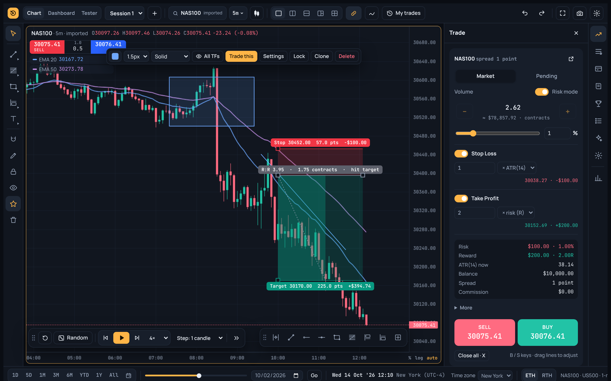
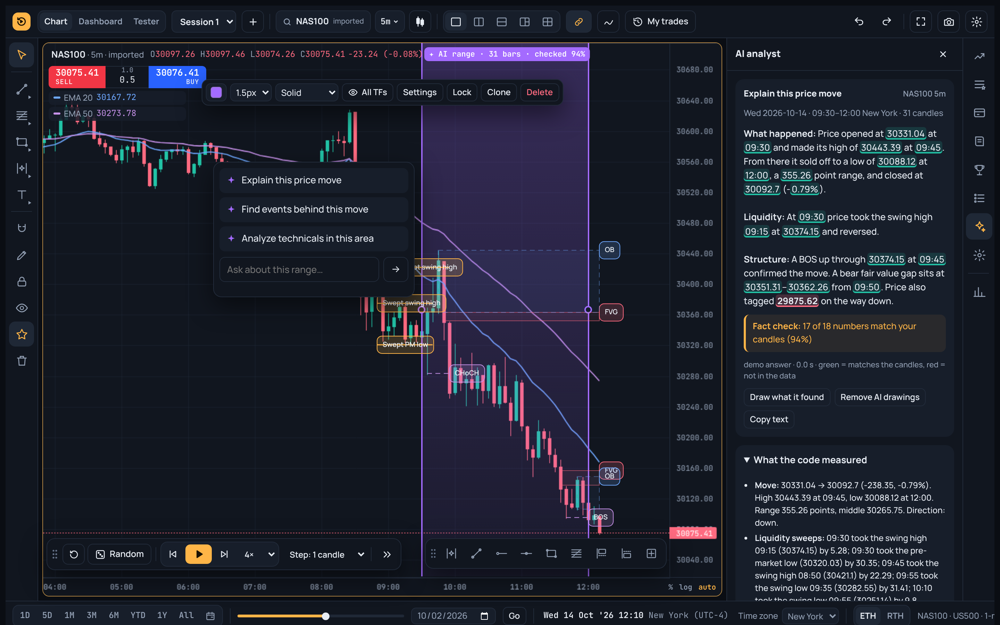
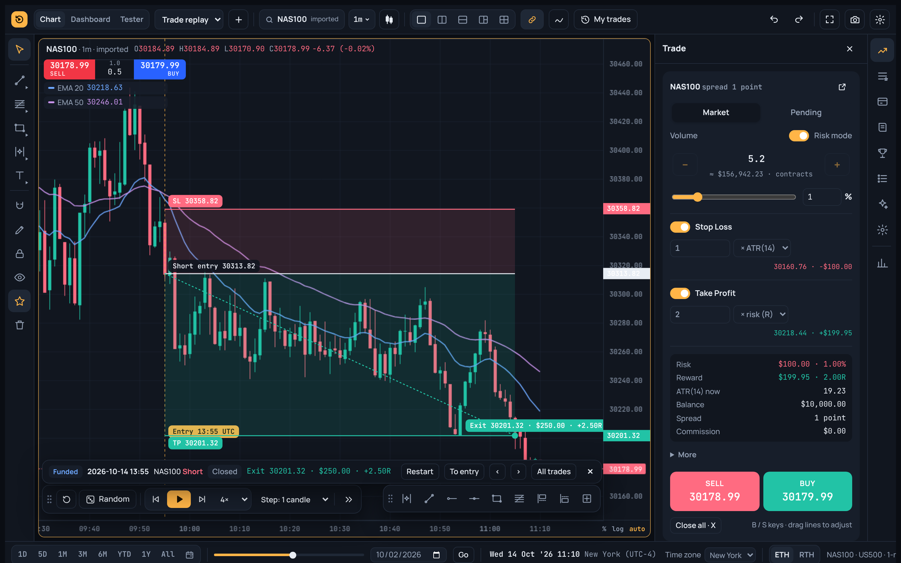
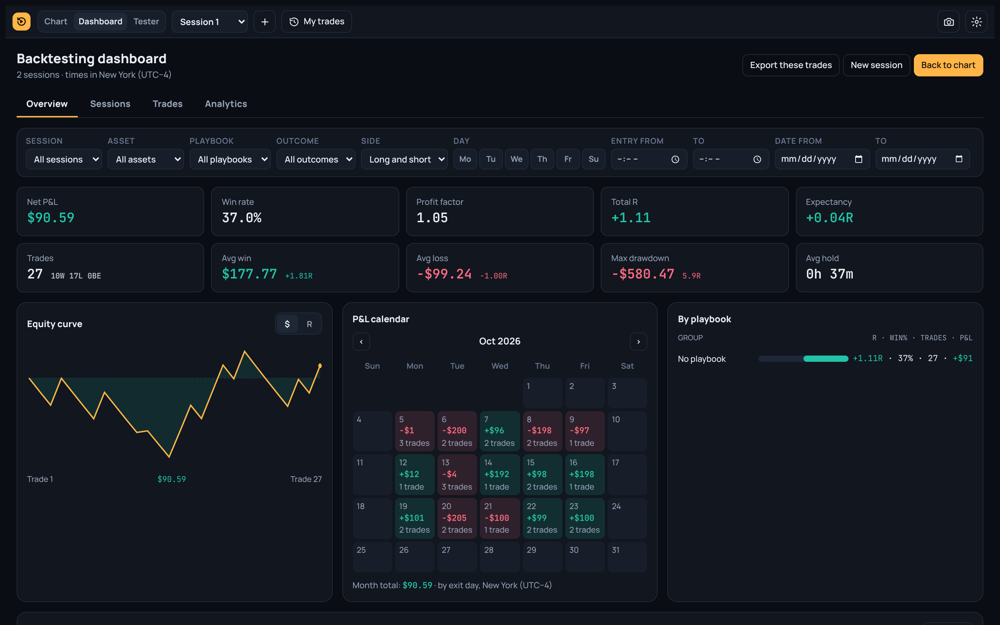
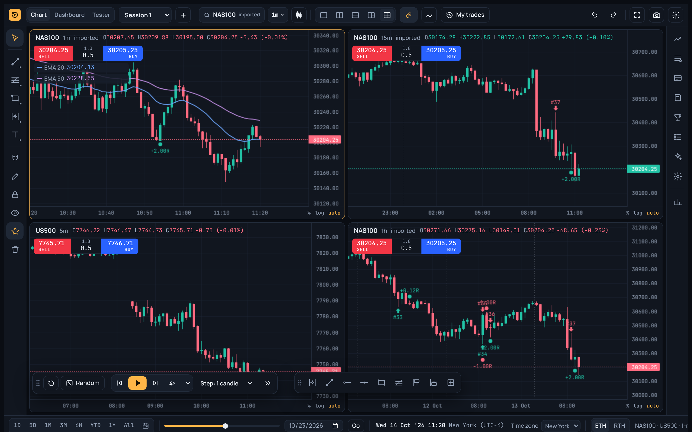
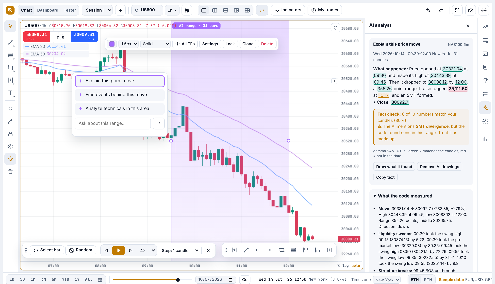

# Replay Desk

A bar-by-bar **trading replay simulator** that runs as **one HTML file** in Chrome or Edge. Load 1-minute candles (for example Dukascopy CSVs), pick a start candle, press play, and practice trading as if the market were live. It has TradingView-style drawing tools, practice sessions, a dashboard, replay of your own past trades, and an **AI analyst that explains any price range you select and is fact-checked by code**.

No server and no account. Everything is saved in your browser.



## What it does

- **Bar replay.** Step candle by candle or press play at different speeds. Jump to a date or a random day. Regular or extended hours, any time zone.
- **Up to four linked charts.** Different symbols and timeframes side by side, all moving on the same replay clock.
- **Drawing tools that behave like TradingView.** Trend lines, zones, long and short position tools with live risk-to-reward, vertical lines and text. Click to select, drag to move, right-click for options.
- **Practice trading.** Buy and sell with stop loss and take profit. Results are tracked in R (risk multiples) and in money.
- **Replay my trades.** Load a trade journal file, filter by account or symbol, and replay any past trade from before the entry. Entry, stop and target are drawn on the chart and the result is revealed when price gets there.
- **Dashboard and analytics.** Equity curve, win rate, profit calendar, R distribution, long vs short, results by weekday.
- **AI range.** Drag across candles and ask the AI to explain the move, analyse the technicals or grade a trade. Details below.

| | |
|---|---|
|  |  |
| AI range with the fact check | Replaying a past trade |
|  |  |
| Dashboard | Four linked charts |

More screenshots are in [docs/screenshots](docs/screenshots). The trades shown are demo practice trades on real NAS100 and US500 candles. The AI text in screenshot 02 is a demo answer written from the real measured facts, with one wrong price added on purpose to show the fact check catching it.

## AI range: AI that analyses a price range

Pick the **AI range** tool (✦), drag across some candles, and choose:

- **Explain this price move**
- **Find events behind this move** (scheduled US data times, plus your own news calendar CSV)
- **Analyze technicals in this area**
- **Grade my trade** (shows when one of your replay trades is inside the range)
- **Ask about this range…** (your own question)



*Screenshot: a demo answer with a deliberately wrong price (25,111.50), an unknown time (10:17) and a made-up "SMT". The fact check marks all three.*

### How it works

1. **Code measures the facts. No AI.** For the selected candles it finds the move (open, high, low, close, range), swings, structure breaks (BOS / CHoCH), liquidity sweeps of session levels (previous day, Asia, London, pre-market) and swing points, fair value gaps (and whether they are still open), order blocks, big displacement candles, and SMT against a second index (NQ vs ES).
2. **The AI only writes it up.** The facts go to the model as JSON with strict rules: use only these facts, copy numbers exactly, never guess what comes next.
3. **Every answer is fact-checked.** Code pulls each price, time, percent and pattern word out of the answer and checks it against the facts. Green = matches the candles, red = not in the data, amber = a time the code never measured. A pattern the code didn't find (for example "SMT" when there is none) gets a warning.
4. **No peeking in replay.** The AI only gets candles up to the replay time.
5. **Draw what it found.** One click turns the open FVGs, order blocks, sweeps and structure breaks into normal drawings you can edit or delete.
6. **Grade my trade.** Checks a replay trade against the playbook: New York AM window, liquidity sweep, SMT, structure break after the sweep, entry inside an FVG or order block, stop beyond the sweep wick. These checks are code, so the AI can't change them.

**Free by default:** it uses [Ollama](https://ollama.com) on your own PC (`gemma3:4b` by default). A Claude API key is optional.

### Does the fact check work?

`ai-eval/checker-selftest.mjs` writes answers that quote true numbers, slips in wrong ones, and counts what the checker catches. On 50 New York morning ranges of real NAS100 5-minute candles (Nov 2025 to Nov 2026):

| | Result |
|---|---|
| Wrong prices caught (0.15% to 2% off) | 94% |
| Wrong times caught | 100% |
| Made-up patterns caught | 100% |
| True numbers wrongly flagged | 0% |

The misses are wrong prices that land within about 1.5 points of a different real level, so they can't be told apart by number alone.

### Model eval

`ai-eval/run-eval.mjs` runs local models on the same 50 ranges and scores every answer with the checker: numbers correct, answers with no wrong number, answers that invent a pattern, and speed. Results go to `ai-eval/results/<date>/summary.md`.

```
node ai-eval/run-eval.mjs --nq <NQ 1m csv> --es <ES 1m csv> --models gemma3:4b,qwen2.5:3b,llama3.2:3b
```

## Run it

1. Download `replay-desk.html` and open it in Chrome or Edge.
2. Import 1-minute candles: **More → Import**.
3. For AI range: install Ollama, run `ollama pull gemma3:4b`, and once run `setx OLLAMA_ORIGINS *` (Windows) so Ollama answers a page opened from a file. Then restart Ollama.

## Tests

```
node --test tests/*.test.mjs
node ai-eval/checker-selftest.mjs
```

The AI engine lives in `replay-desk.html` between `/*AIR-ENGINE-START*/` and `/*AIR-ENGINE-END*/`. The tests and evals load it from there, so there is only one copy of the code.

## How it was built

I designed this app as a trader: what it should do, how it should behave, and what counts as a bug. The code was written with **Claude as an AI pair programmer** under my direction. I tested every build by hand on real charts and sent it back until it behaved like the tools I trade with.

Because AI wrote most of the code, the project leans on checks rather than trust:

- Unit tests for the AI engine (`tests/`).
- A self-test that measures how well the fact check catches wrong numbers (`ai-eval/`).
- Automated browser tests (Playwright) for the drawing tools: selection, more than 700 drag checks across timeframes and weekend gaps, and randomised "fuzz" runs.

## Built with

Plain HTML, CSS and JavaScript in one file, [Lightweight Charts](https://github.com/tradingview/lightweight-charts) for candles, Ollama or the Claude Messages API for the AI text, Node's built-in test runner and Playwright for testing.
